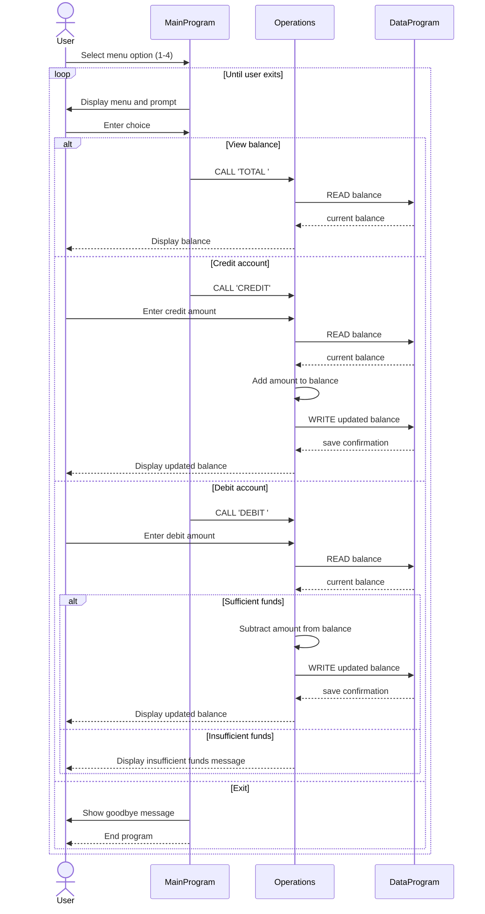

# COBOL Student Account System Overview

This project contains a simple COBOL-based account management program that models a student account balance and supports viewing, crediting, and debiting funds. The application is structured as a small modular program with separate files for the user interface, business operations, and data persistence.

## File purposes

### src/cobol/main.cob
Purpose:
- Entry point for the user interface.
- Presents a menu for account actions and routes user choices to the account operations program.

Key behavior:
- Displays the account menu with these choices:
  - View Balance
  - Credit Account
  - Debit Account
  - Exit
- Accepts a numeric menu selection from the user.
- Calls the `Operations` program with operation codes:
  - `TOTAL ` for balance inquiry
  - `CREDIT` for adding funds
  - `DEBIT ` for withdrawing funds
- Repeats until the user chooses to exit.

Notes:
- Invalid menu entries display an error and prompt again.
- This is the interactive front-end of the student account system.

### src/cobol/operations.cob
Purpose:
- Implements the business logic for student account transactions.
- Represents the operations layer between the user menu and the persistent balance storage.

Key functions:
- `TOTAL `
  - Reads the current balance from `DataProgram`.
  - Displays it to the user.
- `CREDIT`
  - Prompts for a credit amount.
  - Reads the current balance.
  - Adds the amount.
  - Writes the updated balance back to storage.
  - Displays the new balance.
- `DEBIT `
  - Prompts for a debit amount.
  - Reads the current balance.
  - Validates that sufficient funds exist.
  - Subtracts the amount and writes it back if allowed.
  - Displays a message if the account does not have enough money.

### src/cobol/data.cob
Purpose:
- Acts as the data access / storage routine for the account balance.
- Holds the current value of the balance and supports read/write operations.

Key behavior:
- Initializes a storage balance to `1000.00`.
- Accepts an operation type in the linkage section:
  - `READ` returns the stored balance to the caller.
  - `WRITE` updates the stored balance from the value passed by the caller.
- Uses COBOL `LINKAGE SECTION` parameters to exchange data between programs.

## Business rules for student accounts

The current implementation establishes the following rules:

1. Starting balance
   - Every account starts with a balance of `1000.00`.

2. Balance inquiry
   - A user can check the current balance at any time.

3. Credit rule
   - A credited amount is added directly to the current balance.
   - No minimum or maximum credit limit is enforced in the current logic.

4. Debit rule
   - A debit is allowed only when `FINAL-BALANCE >= AMOUNT`.
   - If the account balance is lower than the requested debit, the program rejects the transaction and shows:
     - `Insufficient funds for this debit.`

5. Persistence model
   - The balance is stored in a single working-storage value inside `DataProgram`.
   - In this simplified version, the data remains valid only for the lifetime of the running program session.

6. Menu flow
   - Users can continue operating on the account until they explicitly select the exit option.

## Transaction flow summary

The typical flow is:

1. `MainProgram` shows the menu.
2. The user selects an action.
3. `Operations` receives the operation code.
4. `Operations` calls `DataProgram` to read or write the balance.
5. The updated balance is displayed back to the user.

## Example scenarios

- View balance:
  - Displays the current amount in the account.

- Credit $250:
  - Reads the current balance, adds `250.00`, and saves the new total.

- Debit $75:
  - Reads the current balance, subtracts `75.00`, and saves the new total if funds are available.

- Debit more than available:
  - Rejects the transaction and prevents a negative account balance.

## Overall purpose

This COBOL program models a basic student account ledger with a front-end menu, transactional operations, and a single persistent balance record. It is intentionally simple and demonstrates how legacy COBOL programs can structure user interaction, business rules, and storage in separate modules.

## Sequence diagram

